# אאורה AI-ERP – אוטומציה למכירת דירות עם n8n וסוכני AI

פרויקט גמר בקורס "בינה מלאכותית ואוטומציות" של ג'ון ברייס.
המערכת מנהלת את מחלקת המכירות והשירות לרוכשים של חברת נדל"ן (מבוסס על אאורה ישראל, עם נתונים בדויים): קליטת מתעניינים, מייל מכירה אישי עם דירות פנויות, זיהוי תשובות, מענה אוטומטי לרוכשים מתוך מאגר ידע, הפקת דרישות תשלום עם מע"מ, ודוח מנהל במייל.

> כל הנתונים, המחירים ומסמכי המדיניות בפרויקט בדויים ונכתבו לצורך לימודי בלבד.

## ארכיטקטורה

| שכבה | כלי | תפקיד |
| --- | --- | --- |
| נתונים | Airtable | 4 טבלאות: Leads, Apartments, PaymentRequests, Tasks |
| לוגיקה | n8n Cloud | 8 תהליכים, 3 סוכני AI ומאגר ידע וקטורי (RAG) |
| מודלים | OpenAI | מודל שפה לניסוח + Embeddings למאגר הידע |
| ערוץ תקשורת | Gmail | כל התקשורת עם מתעניינים, רוכשים והמנהל היא במייל (במקום טלגרם) |
| מסמכים | Google Drive | שמירת דרישות התשלום |
| ממשק | app/dashboard.html | לוח ניהול בעברית: מחוונים, טבלאות, הוספה ועריכה |

```
טופס באתר ─┐                       ┌─► Airtable (נתונים)
מייל רוכש ──┼─►  n8n + סוכני AI  ───┼─► Gmail (מיילים יוצאים)
מייל מנהל ──┤     + מאגר ידע       └─► Google Drive (מסמכים)
תזמון ──────┘
```

## התהליכים (תיקיית workflows)

| # | תהליך | מה הוא עושה | טריגר |
| --- | --- | --- | --- |
| WF1 | קליטת מתעניינים | טופס → בדיקת כפילות לפי מייל → רשומה חדשה בסטטוס "חדש" | טופס n8n |
| WF2 | סוכן מכירות – מייל ראשון | מסנן ב-Airtable דירות **פנויות** לפי פרויקט, חדרים ותקציב → מודל השפה מנסח מייל אישי → שליחה ועדכון סטטוס + GmailThreadId | כל 3 שעות |
| WF3 | סוכן מכירות – בדיקת תשובות | מזהה תשובת מתעניין (לפי שרשור או כתובת) → סטטוס "ענה" → משימה לנציג | כל 30 דקות |
| WF4 | מדיניות → מאגר ידע | 10 מסמכי מדיניות → Embeddings → מאגר וקטורי | ידני (טופס) |
| WF5 | דירות → מאגר ידע | טבלת Apartments → משפט לכל דירה → מאגר וקטורי | ידני |
| WF6 | סוכן שירות רוכשים | עונה למיילים לכתובת השירות מתוך מאגר הידע בלבד; מקרים רגישים → משימה לנציג | מייל נכנס |
| WF7 | דרישות תשלום | מחשב מע"מ 18% → מסמך HTML בעברית → Google Drive → מייל לרוכש עם קובץ מצורף → עדכון טבלה | כל שעה |
| WF8 | סוכן מנהל | מייל "דוח מנהל" מכתובת המנהל בלבד → סיכומים מחושבים מכל הטבלאות → תשובה במייל | מייל נכנס |

## החלטות תכנון

**הנתונים מחליטים, ה-AI מנסח.** בגרסה הראשונה סוכן המכירות חיפש דירות במאגר הווקטורי, והציע גם דירות שמורות ונמכרות – כי בחיפוש לפי דמיון במשמעות, דירה "נמכרה" נראית כמעט זהה לדירה פנויה. בגרסה 2 הסינון נעשה בנוסחה ב-Airtable, ומודל השפה מקבל רשימה מסוננת ורק מנסח. אותו עיקרון בסוכן המנהל: כל המספרים מחושבים בצמתים, והמודל לא מחשב.

**RAG לשאלות פתוחות.** סוכן השירות עונה על שאלות כמו לוח תשלומים, ערבויות, מפרט ושינויי דיירים מתוך מסמכי המדיניות בלבד (knowledge-base/policies), ומעביר לנציג אנושי שאלות משפטיות, תלונות ובקשות לשריון.

**מייל במקום טלגרם.** לקוחות של חברת נדל"ן מתקשרים במייל, ולכן כל הסוכנים עובדים מול Gmail. כתובת השירות היא alias של אותה תיבה (`name+service@gmail.com`).

## מבנה הנתונים (Airtable)

| טבלה | שדות |
| --- | --- |
| Leads | Name · Email · Phone · Project · Rooms · Budget · Status · Created · GmailThreadId |
| Apartments | ApartmentId · Project · Building · Floor · Rooms · Size · Price · Status · Description |
| PaymentRequests | RequestNumber (Autonumber) · BuyerName · BuyerEmail · ApartmentId · Amount · VatAmount · Total (נוסחה) · Status · PdfUrl |
| Tasks | Title · Status · RelatedTo |

שדות Status מוגדרים כטקסט רגיל ולא כרשימה נפתחת, כדי שהתהליכים יוכלו לכתוב ערכים חדשים.

## התקנה

1. יוצרים את ארבע הטבלאות ב-Airtable ומייבאים את `knowledge-base/apartments.csv` לטבלת Apartments.
2. ב-n8n יוצרים חיבורים: Airtable, OpenAI, Gmail, Google Drive.
3. מייבאים את קובצי `workflows/` (Import from File). בכל צומת Airtable בוחרים מחדש את הבסיס והטבלה מהרשימה, ובכל צומת את החיבור המתאים. בצמתי Gmail מחליפים `YOUR_GMAIL` ו-`MANAGER_EMAIL`.
4. מריצים את WF4 (מעלים את קבצי המדיניות) ואת WF5. המאגר יושב בזיכרון של n8n – אחרי כל אתחול מריצים שוב.
5. מפעילים (Publish) את WF1, WF2, WF3, WF6, WF7, WF8.
6. פותחים את `app/dashboard.html` בדפדפן, מזינים טוקן Airtable ומזהה בסיס.

## אבטחה

אין בריפו מפתחות, טוקנים או סיסמאות: מזהי החיבורים והבסיס הוסרו מקובצי ה-workflow, והטוקן בלוח הניהול מוזן ידנית ונשמר רק בדפדפן המקומי. סוכן המנהל מגיב רק לכתובת המנהל.

## מגבלות ידועות

המאגר הווקטורי וזיכרון השיחה יושבים בזיכרון של n8n ונמחקים באתחול. דרישת התשלום נשמרת כ-HTML (המרה ל-PDF ידנית דרך Google Docs) ואינה חשבונית מס רשמית. אין טיפול אוטומטי בשגיאות – הן נראות ב-Executions. לוח הניהול מיועד למשתמש אחד ופונה ל-Airtable ישירות מהדפדפן; בייצור הוא יעבור דרך webhook של n8n.

## צילומי מסך

השרת של (n8n) רץ על גרסת ניסיון, ולכן ייתכן שלא יהיה פעיל בזמן הבדיקה. הצילומים שלמטה מתעדים ריצות אמיתיות של כל התהליכים.

| # | מה רואים | צילום |
|---|---|---|
| 1 | בסיס הנתונים ב-(Airtable) | 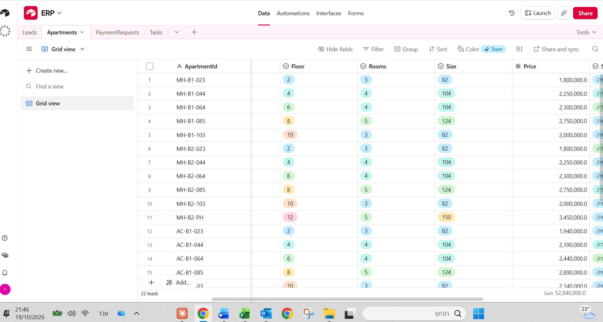 |
| 2 | טופס הלידים (WF1) | 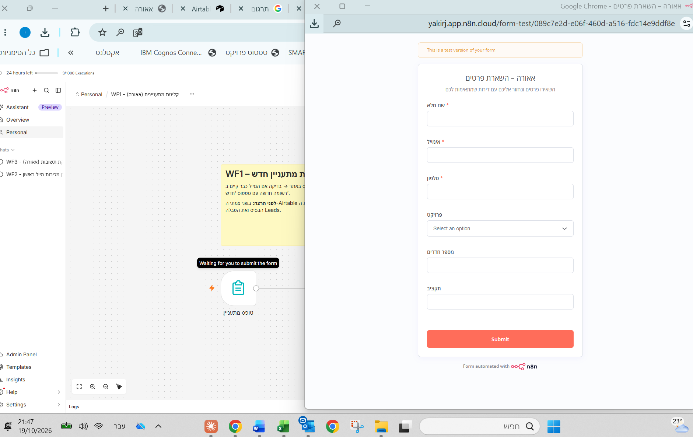 |
| 3 | סוכן המכירות – ריצה מוצלחת (WF2) | 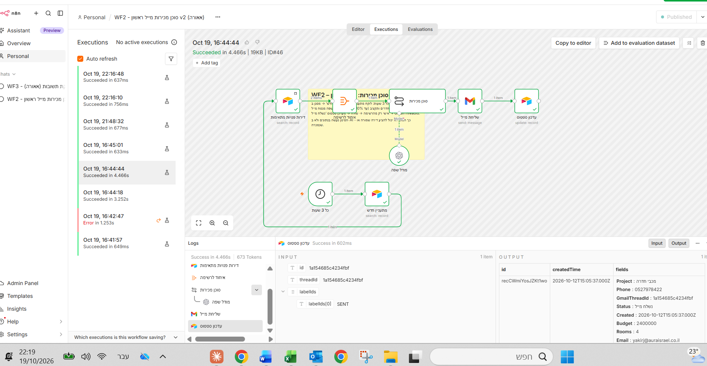 |
| 4 | מייל הצעת דירות שנשלח לליד | 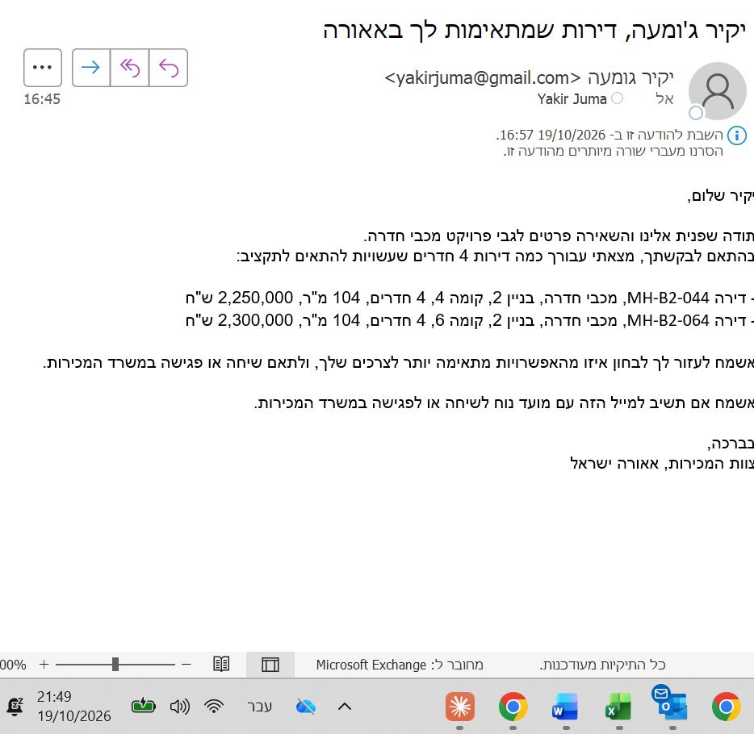 |
| 5 | משימת מעקב שנוצרה (WF3) | 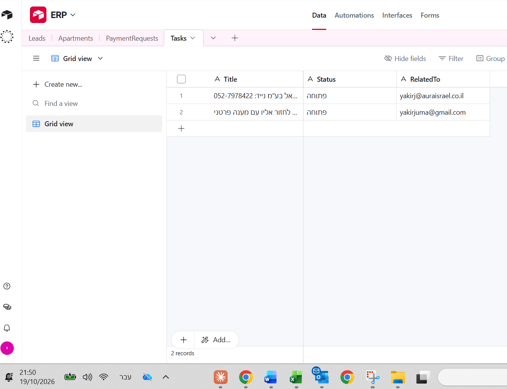 |
| 6 | סוכן השירות עונה מתוך מאגר הנהלים (WF6) | 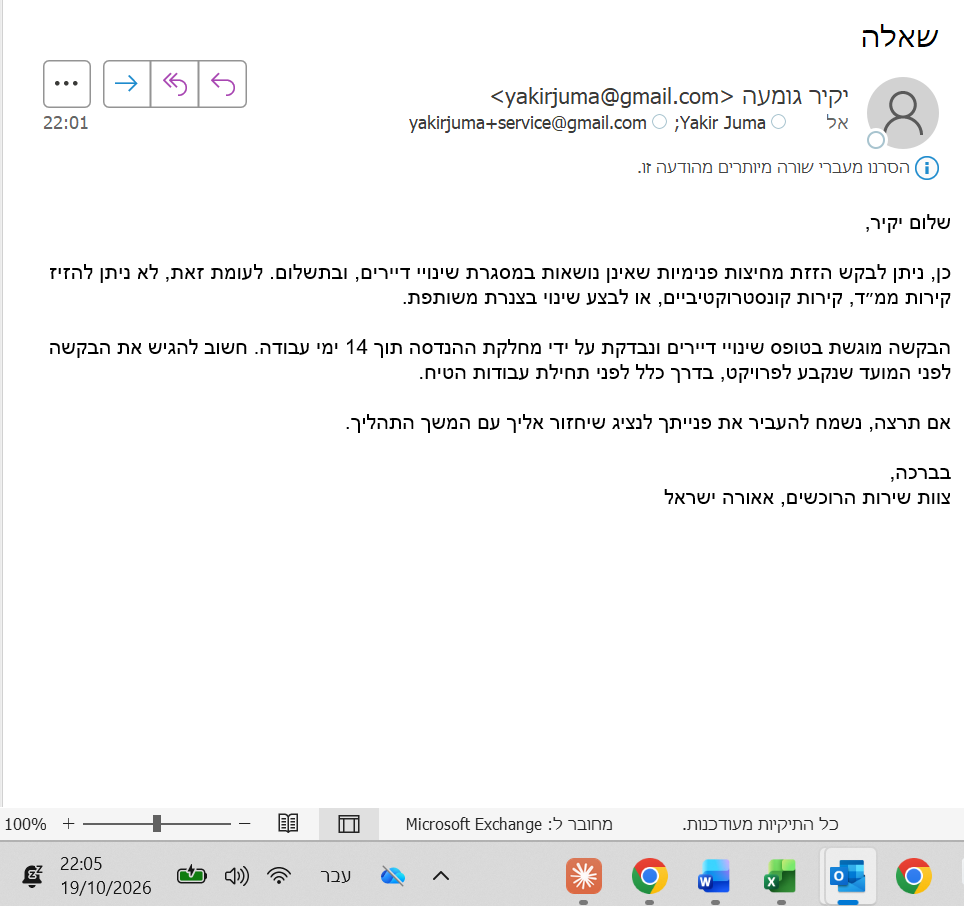 |
| 7 | מייל דרישת תשלום (WF7) | 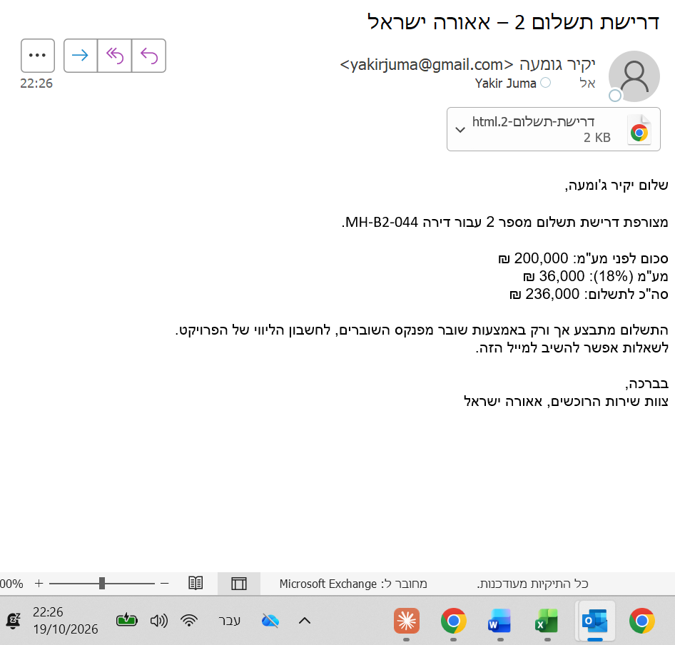 |
| 8 | מסמך דרישת התשלום המצורף | 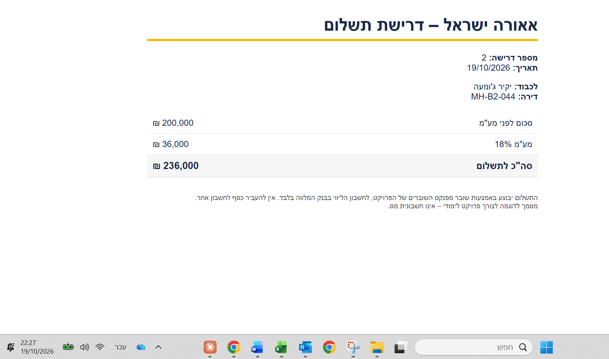 |
| 9 | דוח מנהל (WF8) | 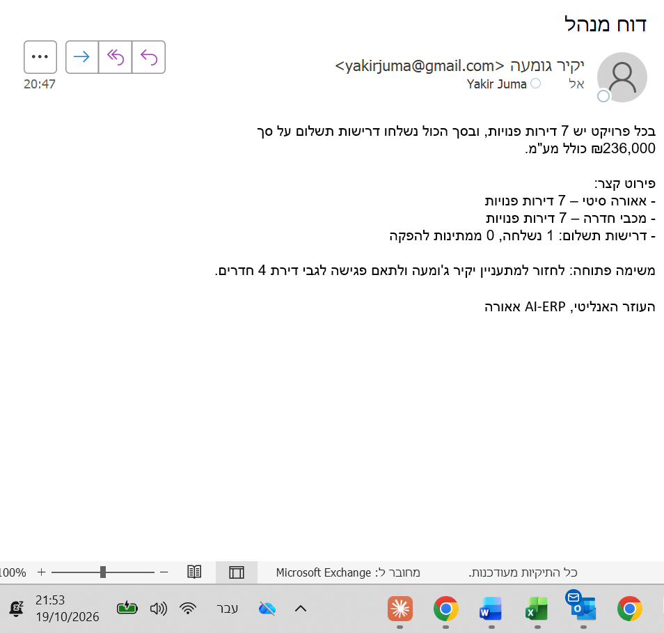 |
| 10 | לוח הבקרה (app/dashboard.html) | 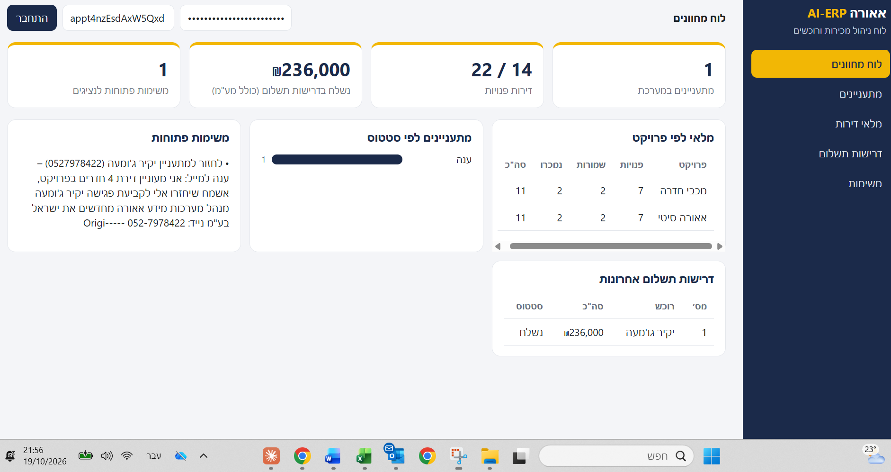 |
| 11 | רשימת התהליכים ב-(n8n) | 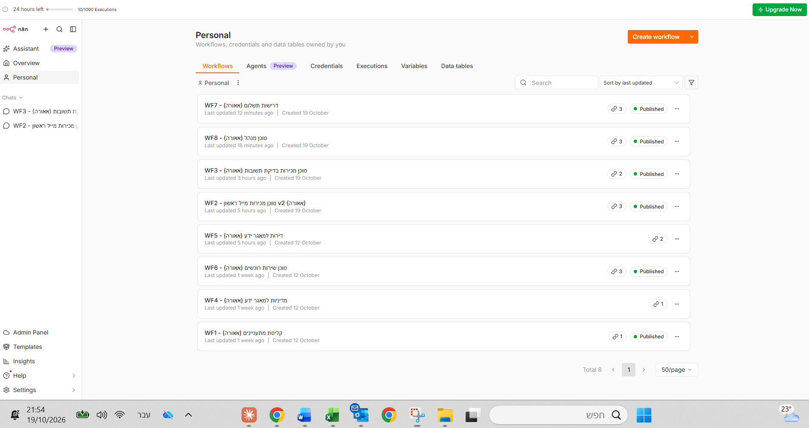 |

## מבנה הריפו

```
docs/            מסמך האפיון
workflows/       WF1–WF8 לייבוא ל-n8n
knowledge-base/  מסמכי מדיניות + קובץ הדירות
app/             לוח הניהול
```
